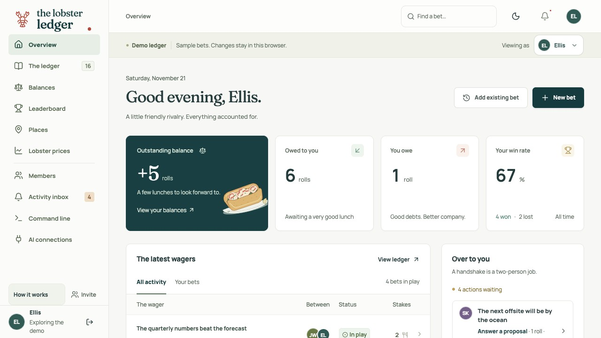

# The Lobster Ledger

A self-hosted ledger for friends who settle bets in lobster rolls. Agree on the stakes, record who won, and see who owes lunch. Both bettors confirm the result and the delivery.

[Try the local demo](#try-the-local-demo) · [Self-host a ledger](docs/deployment.md) · [Contribute](CONTRIBUTING.md)



## Try the local demo

Use Node.js 24.21.0 and pnpm 10.30.3. Run these commands from the repository root.

```sh
pnpm install --frozen-lockfile
pnpm dev
```

Open [the demo on your machine](http://127.0.0.1:5173/?demo=1). It starts with fictional wagers and runs entirely in your browser without signing in.

Choose **New bet** and put a roll on a future event. Switch to the other bettor under **Viewing as** to approve the terms, then open **The ledger** to see the wager in play. Changes stay in this browser. **Reset demo** in the avatar menu restores the sample ledger.

## Inside the ledger

- **Wagers.** Record terms, deadlines, and how the winner will be decided. Both bettors approve the agreement. They can request a judge or agree on a prompt for ChatGPT and record the response.
- **Balances.** See who owes whom, confirm deliveries, and offset rolls that two people owe each other. Export the ledger as CSV or its audit history as JSON.
- **Places and prices.** Map lobster-roll spots and record menu prices. Follow a separate chart of Maine's annual lobster boat prices. [Market data and sources](docs/lobster-market.md)
- **Connected clients.** Work from the command line or authorize an MCP client in the browser. [CLI guide](docs/cli.md) · [MCP guide](docs/mcp.md)

## Run a shared ledger

One deployment serves one invite-only group. The React and TypeScript app uses a Cloudflare Worker, D1 for storage, and Google for sign-in. The first owner can invite the rest of the group. [Self-hosting guide](docs/deployment.md)

For development, see the [local setup and tests](docs/development.md), [architecture](docs/architecture.md), and [wager workflow](docs/design.md).

## Project information

[Contributing](CONTRIBUTING.md) · [Report a security issue](SECURITY.md) · [Release guide](docs/releasing.md) · [MIT License](LICENSE) · [Third-party notices](THIRD_PARTY_NOTICES.md)
